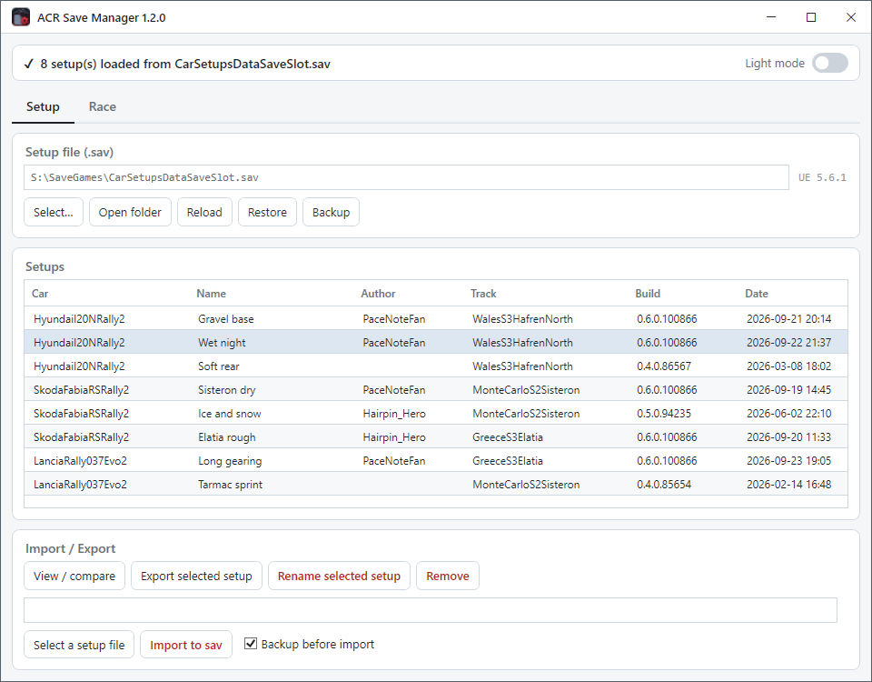
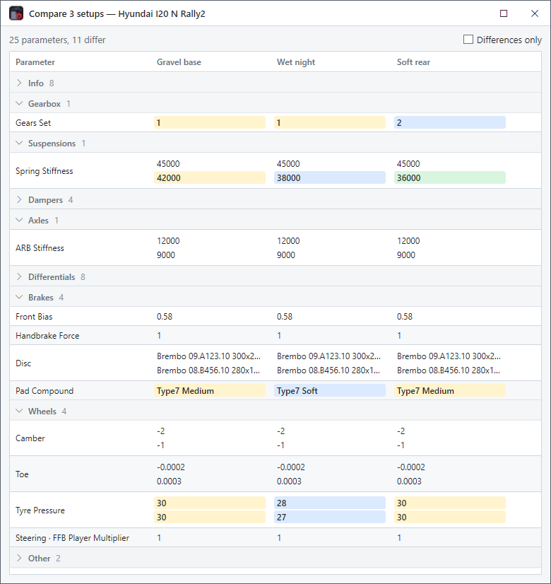

# ACR Save Manager

[](https://github.com/FlorentDChamps/acr-save-manager/actions/workflows/build.yml)

**Gestionnaire de sauvegardes pour Assetto Corsa Rally — partager ses setups et ses rallyes, garder des backups.**

*Lire ce document en [anglais / English](README.md).*

ACR enferme chaque setup voiture et chaque configuration d'événement dans des
fichiers de sauvegarde binaires Unreal Engine, sans aucun moyen de les renommer,
supprimer, sauvegarder ou partager depuis le jeu. Cet outil ouvre ces fichiers
directement : il liste vos setups, **exporte un setup vers un fichier `.setup` que
vous pouvez envoyer à un coéquipier**, réimporte les siens, renomme et supprime des
entrées sur place, modifie les Rally Weekends et le Single Stage et garde une
bibliothèque de rallyes à y charger, choisit la voiture avec laquelle le jeu
démarre, et exporte toute la sauvegarde joueur en JSON lisible — avec backups
horodatés et restauration en un clic.

> ⚠️ **Fermez le jeu avant toute écriture.** ACR garde ses fichiers de sauvegarde
> ouverts tant qu'il tourne, et les réécrit depuis la mémoire en quittant : une
> écriture faite jeu ouvert est soit refusée, soit silencieusement écrasée. La
> lecture est toujours sans risque.

> **Projet amateur non officiel.** Sans aucune affiliation ni approbation de Kunos
> Simulazioni, Supernova Games Studios ou 505 Games. *Assetto Corsa* est une marque
> de ses propriétaires respectifs ; le nom n'est utilisé ici que pour indiquer la
> compatibilité. L'outil lit et écrit **uniquement vos fichiers de sauvegarde
> locaux**.

> ⚠️ **Seule l'écriture comporte un risque.** Lire, visualiser, exporter et
> sauvegarder ne changent rien aux fichiers du jeu. Une écriture — Import, Rename,
> Remove, Write, Restore — réécrit une sauvegarde que le jeu n'attend de personne
> d'autre : elle peut coûter un setup ou un profil, qu'un `.bak` remet en place, et,
> si le jeu embarquait un jour un anti-triche, pourrait passer pour de la triche.
> Il n'en embarque aucun aujourd'hui, et l'outil vérifie avant chaque écriture
> (voir [Contrôle anti-triche avant écriture](#contrôle-anti-triche-avant-écriture)).
> Vous écrivez à vos risques : l'auteur n'est pas responsable de ce qu'une écriture
> peut coûter.

**Sommaire**

- [Fonctionnalités](#fonctionnalités)
- [Formats de fichiers](#formats-de-fichiers)
- [Démarrage](#démarrage)
- [Antivirus & SmartScreen](#antivirus--smartscreen)
- [État & limites](#état--limites)
- [Structure du projet](#structure-du-projet)
- [Soutenir le projet](#soutenir-le-projet)
- [Licence](#licence)

---

## Fonctionnalités

### Onglet Setup — setups voiture (`CarSetupsDataSaveSlot.sav`)



La sauvegarde des setups contient tous les setups enregistrés dans le jeu,
rangés par voiture. Chacun porte son nom, son auteur, la spéciale sur laquelle il
a été fait, les surfaces, météos et modes de jeu pour lesquels il est gardé, la
version du jeu qui l'a écrit et sa date — puis tous les réglages de la voiture,
du jeu de rapports aux pressions des pneus. Le jeu ne les montre que dans ses
propres menus ; ici, ils deviennent une liste que l'on peut lire, comparer,
partager et ranger.

Ctrl+clic et Maj+clic sélectionnent plusieurs setups : **View / compare**,
**Export** et **Remove** les prennent tous, **Rename** un seul à la fois.

- **Chargement automatique** — `%LOCALAPPDATA%\acr\Saved\SaveGames\CarSetupsDataSaveSlot.sav`
  est ouvert au démarrage ; n'importe quel autre `.sav` peut être sélectionné.
- **Liste des setups** — voiture, nom, auteur, spéciale, version du jeu qui a écrit
  l'entrée et sa date. Une sauvegarde en mélange généralement plusieurs.
- **View / compare** : tous les paramètres du setup sélectionné, ou de
  plusieurs setups d'une même voiture côte à côte — voir
  [Visualiser et comparer des setups](#visualiser-et-comparer-des-setups).
- **Export** du setup sélectionné vers un fichier binaire `.setup` accompagné d'un
  `.json` lisible, nommé par défaut
  `{Voiture}_{Spéciale}[_{Météo}]_{Nom}[_{Auteur}]_{Horodatage}.setup` — c'est
  cette paire que vous envoyez à un autre joueur. La météo n'apparaît dans le nom
  que si le setup n'en retient qu'une. Le `.json` suit le format de
  [*AC Rally car setup manager*](https://www.overtake.gg/downloads/ac-rally-car-setup-manager-by-sheldor.85944/)
  de Sheldor — les paramètres sous forme lisible, et l'entrée elle-même — suivi
  des météos, des tags de mode de jeu et de la date du setup. Plusieurs setups
  sélectionnés ensemble (Ctrl+clic, Maj+clic) sont exportés dans un seul `.json`
  qui les contient tous, nommé par défaut `[{Voiture}_]{n}_setups_{Horodatage}.json`.
- **Import** d'un fichier `.setup` dans la sauvegarde courante, ou d'un `.json` à
  ce format, qu'il vienne de l'un ou l'autre outil, avec un avertissement
  s'il vient d'une autre version du jeu. Un `.json` contenant plusieurs setups
  les ajoute en une seule écriture. Le nom du setup est toujours demandé
  (pré-rempli avec l'original, incrémenté automatiquement en cas de collision) : un
  setup importé ne remplace jamais un des vôtres en silence. Pour un fichier qui
  en contient plusieurs, **Skip** écarte ce setup et passe au suivant : vous
  pouvez n'en prendre que certains.
- **Rename** d'un setup et **Remove** des setups sélectionnés, sur place, dans
  le fichier. Plusieurs setups sont retirés en une seule écriture, avec un seul
  backup.
- **Backup / Restore** du fichier de sauvegarde, et **Open folder** pour l'ouvrir
  dans l'Explorateur.

#### Visualiser et comparer des setups



**View / compare**, ou un double-clic sur un setup, ouvre une fenêtre à part :
la fenêtre principale reste utilisable, et rien n'est écrit. Elle montre les
setups tels qu'ils étaient à son ouverture.

- **Info**, replié à l'ouverture, donne le nom du setup, son auteur, la
  spéciale, la surface, la météo, le mode de jeu, la version et la date.
- Les paramètres suivent, regroupés par partie de la voiture : Gearbox,
  Suspensions, Dampers, Axles, Differentials, Brakes, Wheels, Other. Un clic sur
  l'en-tête d'un groupe le replie.
- Les valeurs sont mises en clair : `36.000000` donne `36`,
  `(LSDRampAngles:45_60)` donne `45° / 60°`, un jeu de rapports son numéro dans
  le jeu (`Set0` donne 1), et `(Gears:27//8)` donne `27//8`, comme dans le jeu.
- Un paramètre réglé roue par roue tient sur une ligne, placé comme la voiture
  vue de dessus : l'avant en haut, la gauche à gauche. Il ne montre pas plus de
  détail que nécessaire : un essieu dont la gauche et la droite sont égales
  montre une seule valeur, quatre roues égales une seule en tout. Un paramètre
  par essieu montre l'avant au-dessus de l'arrière, et les différentiels se
  séparent en avant, arrière et central.
- Sélectionnez plusieurs setups d'une même voiture pour les comparer : une
  colonne chacun, les valeurs qui diffèrent en surbrillance — sur une ligne de
  roues, seulement les roues qui diffèrent — et comptées en haut. Chaque valeur a
  sa couleur, partagée par les setups qui l'ont : à partir de trois setups, on
  voit lesquels se rejoignent.
  **Differences only** masque le reste. Des setups de voitures différentes ont
  trop peu de paramètres en commun, et sont refusés.
- Une valeur trop longue pour sa colonne finit par « … » et s'affiche en entier
  sous la souris ; Ctrl+C copie les lignes sélectionnées.

Les libellés sont les clés de la sauvegarde elle-même, espacées —
`Wheels.FrontLeft.TyrePressure` devient *Tyre Pressure* sur la ligne Wheels :
les noms et unités que le jeu affiche à l'écran ne sont pas stockés dans le
fichier.

### Onglet Rally (`PlayerDataSaveSlot.sav`)

Un rallye contient toutes les options des menus Rally Weekend du jeu, hors ligne
comme en ligne : les règles, les adversaires et l'ordre de départ que prend un
week-end hors ligne, le lobby que prend un week-end en ligne, et le calendrier
spéciale par spéciale. Un même rallye s'écrit dans l'un ou l'autre Rally Weekend
de la sauvegarde, ou dans les deux.

- **À gauche**, les deux Rally Weekends de la sauvegarde, puis la
  **bibliothèque** : les rallyes gardés en fichiers dans un dossier `rallies` à
  côté de l'appli. En choisir un l'affiche dans l'éditeur. Un week-end de la
  sauvegarde prend à l'autre ce qui lui manque : le week-end hors ligne reçoit
  le lobby du week-end en ligne, le week-end en ligne les adversaires et l'ordre
  de départ du hors ligne.
- **L'éditeur** affiche les règles avec les valeurs que proposent les menus du
  jeu, puis le calendrier spéciale par spéciale — partir d'un calendrier du jeu,
  ajouter, retirer ou déplacer des spéciales et des jours, choisir pour chaque
  spéciale le parc d'assistance, l'heure de départ, la météo, la prévision, la
  route et la vitesse du temps. Il respecte les règles du jeu : un seul lieu,
  4 jours au plus, 4 spéciales par jour comme dans le menu (5 dans un fichier
  de rallye, comme le calendrier d'Alsace du jeu), un parc d'assistance en
  début de journée, le hardcore qui impose les dégâts et la pénalité réaliste,
  chaque valeur dans ce que proposent les menus. Ce que le jeu refuserait est
  listé en bas.
- **New**, **Duplicate**, **Delete** (vers la corbeille), **Import…** (copie des
  fichiers de rallye dans la bibliothèque) et **Open folder** gèrent la
  bibliothèque.
- **Save to library** écrit le rallye dans `rallies\<nom>.json` ; renommer un
  rallye de la bibliothèque renomme son fichier, après confirmation, et envoie
  l'ancien à la corbeille. Les fichiers sont du JSON
  lisible, faits pour être partagés : envoyez-en un à un ami, qui l'importe.
- **Write to .sav** écrit le rallye dans les week-ends cochés — hors ligne, en
  ligne ou les deux —, chacun sous la forme que le jeu enregistre, avec un seul
  résumé à confirmer, le résultat relu avant et un seul backup. L'écriture est
  refusée tant que le jeu tourne (il l'écraserait) et dans un week-end où un
  rallye est en cours. Ce qu'aucun menu n'affiche (les options de pneus et de
  carburant, pas encore dans le jeu) reste celui de la sauvegarde.
- **Single Stage**, coché seul ou avec les week-ends, écrit la première spéciale
  du rallye dans les modes à spéciale unique : Single Stage hors ligne et en
  ligne et Free Practice prennent les règles du rallye et la météo de cette
  spéciale, et la sélection de spéciale qu'ils partagent prend la spéciale. Le
  jeu garde une seule spéciale pour tous ces modes, la dernière affichée : ils
  s'écrivent donc ensemble ; la voiture ne change pas.
- **Car** choisit la voiture que les menus du jeu affichent pour tous les modes,
  et **Write car** l'écrit seule dans la sauvegarde : les rallyes ne contiennent
  pas de voiture.
- **Export JSON** exporte toute la sauvegarde joueur en document JSON structuré,
  pour inspection ou comparaison entre versions du jeu.
- **Backup / Restore** du fichier de sauvegarde.

### Backups

| Opération | Backup |
|---|---|
| Rename · Remove setup · Write to .sav | `.bak` horodaté automatique |
| Import setup | case à cocher à côté du bouton, activée par défaut |
| Restore | demandé à chaque fois, avant la confirmation finale |
| Tout le reste (liste, export, JSON) | lecture seule, la sauvegarde n'est pas touchée |

Le `.bak` est écrit dans le dossier `ACRSaveManager Backups`, à côté de la
sauvegarde qu'il copie, sous la forme `{NomSauvegarde}_{aaaaMMjj_HHmmss}.bak`, et
**Restore** remet n'importe lequel en place. Les deux sauvegardes rangent leurs
backups dans le même dossier, sous la même extension : **Restore** lit donc
d'abord le fichier choisi et refuse un backup de setups dans l'onglet Rally, ou un
backup joueur dans l'onglet Setup.

- **Les 10 backups les plus récents de chaque sauvegarde sont gardés** ; les plus
  anciens partent à la Corbeille à chaque nouveau backup. `BackupsKept` dans
  `ACRSaveManager.config` règle ce nombre, et `0` les garde tous.
- **Pas de doublon** : si la sauvegarde est identique à son dernier backup, aucun
  nouveau n'est écrit.
- Seuls les fichiers nommés comme ci-dessus comptent : renommez un `.bak` (par
  exemple `CarSetupsDataSaveSlot_avant-rallye.bak`) et il est gardé pour de bon.
- Les backups que les versions précédentes écrivaient à côté de la sauvegarde
  rejoignent le dossier au prochain backup de cette sauvegarde.

### Vérification d'intégrité avant écriture

Chaque écriture reconstruit d'abord le fichier en mémoire, puis relit ce tampon et
contrôle les invariants du format : `size_field` cohérent avec la nouvelle taille,
nombre de setups ou chaque partie de la liste conforme à l'opération, parcours qui
se termine exactement là où il le doit. L'écriture n'a lieu que si tout est
vérifié — un format modifié par une future version du jeu fait donc échouer
l'opération au lieu de produire un fichier que le jeu refuserait.

### Contrôle anti-triche avant écriture

Assetto Corsa Rally n'embarque aucun anti-triche aujourd'hui. Si une mise à jour
en apportait un, modifier ses sauvegardes pourrait passer pour de la triche : avant
chaque écriture, l'outil cherche un dossier `EasyAntiCheat` ou `BattlEye` à côté du
jeu — à côté de l'exe du jeu qui tourne, et à côté du jeu dans chaque bibliothèque
Steam — et refuse d'écrire tant qu'il y en a un. Lire, visualiser, exporter et
sauvegarder ne sont pas concernés. Un jeu installé hors Steam n'est vu que pendant
qu'il tourne.

### Notification de mise à jour au démarrage

Une vérification légère des releases de ce dépôt ; si une version plus récente
existe, une fenêtre pointe vers elle (rien n'est téléchargé sans votre
confirmation) et peut être ignorée par version. Un bouton **Update available**
reste à côté de l'interrupteur de thème tant que vous n'avez pas mis à jour.

---

## Formats de fichiers

| Extension     | Contenu |
|---------------|---------|
| `.sav`        | Fichier de sauvegarde binaire Unreal Engine 5 (format GVAS), celui du jeu |
| `.setup`      | Blob binaire brut d'une entrée setup de `CarSetupsDataSaveSlot.sav` |
| `.json`       | JSON exporté à côté du `.setup`, même nom de base, au format de [*AC Rally car setup manager*](https://www.overtake.gg/downloads/ac-rally-car-setup-manager-by-sheldor.85944/) de Sheldor : les paramètres sous forme lisible, leur hash, et l'entrée en base64. Exporté seul quand plusieurs setups le sont, il les contient tous. Il s'importe comme un `.setup` |
| `rallies\*.json` | Un rallye de la bibliothèque de l'onglet Rally : toutes les options d'un Rally Weekend, hors ligne et en ligne, sous les noms que le jeu donne à leurs valeurs |
| `.bak`        | Copie de sauvegarde horodatée d'un fichier `.sav` |

### D'où vient un fichier

Une entrée setup porte la version du jeu qui l'a écrite — `0.6.0.100866` — donc
un `.setup` indique lui-même son origine. L'appli l'affiche par entrée, dans la
colonne Build et à côté du `.setup` en attente d'import : un fichier de sauvegarde
n'a pas de version unique, il contient des entrées écrites par plusieurs. Ce qu'un
`.sav` possède en propre, c'est sa version de moteur — c'est elle que son badge
affiche.

La sauvegarde joueur, elle, n'enregistre aucune version du jeu : la version de
moteur affichée (`UE 5.6.1`) est le seul marqueur qu'elle contient.

Les structures binaires rétro-conçues sont documentées dans
[`docs/CarSetupsDataSaveSlot_structure.txt`](docs/CarSetupsDataSaveSlot_structure.txt)
et [`docs/PlayerDataSaveSlot_structure.txt`](docs/PlayerDataSaveSlot_structure.txt).

---

## Démarrage

### Prérequis

- Windows 10/11 x64
- [Runtime .NET 10 Desktop](https://dotnet.microsoft.com/fr-fr/download/dotnet/10.0)
  (le SDK pour compiler depuis les sources). S'il manque, Windows affiche au
  premier lancement de l'exe une boîte de dialogue avec le lien de téléchargement
  direct — installez-le une fois, puis relancez.

### Compilation

```
dotnet build        # build debug
publish.bat         # exe Release monofichier dans .\publish\
```

### Tests

```
dotnet test tests/ACRSaveManager.Tests
```

Les tests construisent leurs sauvegardes en code, avec des valeurs inventées. Pour
rejouer les mêmes contrôles sur vos propres sauvegardes, faites pointer
`ACRSM_SAMPLES` sur un dossier qui en contient des copies ; sans elle, ces tests
sont ignorés. Une vraie sauvegarde porte votre nom de joueur et votre progression :
ne la commitez jamais.

### Utilisation

1. **Fermez Assetto Corsa Rally.**
2. Lancez `ACRSaveManager.exe` — les deux fichiers de sauvegarde se chargent
   automatiquement s'ils sont à l'emplacement par défaut. Gardez l'exe dans un
   dossier où vous pouvez écrire : le thème, la disposition de la fenêtre et les
   derniers fichiers ouverts sont enregistrés dans un `ACRSaveManager.config` à
   côté de lui, et la bibliothèque de rallyes est le dossier `rallies` à côté.
3. Onglet *Setup* : sélectionnez un setup et **View / compare** pour le lire —
   ou plusieurs pour les comparer —, **Export selected setup** pour le partager,
   ou **Select a setup file** → **Import to sav** pour en ajouter un reçu.
4. Onglet *Rally* : choisissez un des Rally Weekends de la sauvegarde ou un
   rallye de la bibliothèque, modifiez-le, puis **Save to library** pour le
   garder, ou cochez où l'écrire — Offline, Online, Single Stage — et
   **Write to .sav**.
5. Un souci ? **Restore** sélectionne un `.bak` et le remet en place.

---

## Antivirus & SmartScreen

L'`.exe` publié n'est pas signé numériquement : au premier lancement, Windows peut
donc afficher un avertissement. C'est normal pour un outil open-source non signé —
voici ce qu'il signifie et quoi faire.

- **« Windows a protégé votre ordinateur » (SmartScreen).** Signifie seulement que
  l'éditeur est inconnu, pas qu'une menace a été trouvée. Cliquez **Informations
  complémentaires → Exécuter quand même**.
- **Détection antivirus / Defender.** Un exe monofichier auto-extractible déclenche
  parfois les détecteurs heuristiques. L'application ne touche qu'à vos sauvegardes,
  à leurs backups, aux fichiers que vous exportez et à son propre `.config`, et
  n'utilise le réseau que pour une chose : demander à GitHub, au démarrage, si une
  release plus récente existe. Si Defender la met en quarantaine, c'est un faux
  positif — restaurez-la depuis la quarantaine, ou compilez l'exe vous-même depuis
  les sources (`publish.bat`).

**Vérifiez votre téléchargement.** Chaque [release](https://github.com/FlorentDChamps/acr-save-manager/releases)
publie un checksum SHA-256, livré aussi dans un fichier `.sha256` à côté de l'exe.
Vérifiez que le fichier correspond avant de l'exécuter :

```
certutil -hashfile ACRSaveManager.exe SHA256
```

Si vous préférez ne faire confiance à aucun binaire préconstruit, clonez le dépôt et
lancez `publish.bat` — l'exe obtenu est l'exe que vous exécutez.

---

## État & limites

| Élément | État |
|---|---|
| Liste / export / import / rename / remove des setups | ✅ parsés et réécrits sur place |
| Visualisation & comparaison des setups | 🟡 tous les paramètres, sous leur clé dans la sauvegarde : les libellés et unités du jeu n'y sont pas stockés |
| Onglet Rally : éditeur et bibliothèque | ✅ tous les réglages lus, hors ligne et en ligne, et vérifiés en réécriture à l'octet près ; un week-end écrit est relu avant l'écriture, et le jeu charge un week-end modifié (testé en jeu 0.7) ; un fichier de la bibliothèque se relit en un rallye identique |
| Onglet Rally : Single Stage | ✅ les réglages Single Stage et Free Practice et la sélection de spéciale sont décodés et vérifiés sur des sauvegardes modifiées dans les menus ; le jeu charge ce qui est écrit (testé en jeu 0.7) |
| Onglet Rally : voiture | 🟡 la voiture de la sauvegarde est lue et réécrite, le reste vérifié inchangé ; pas encore testé en jeu |
| Export JSON de la sauvegarde joueur | ✅ tout le fichier ; une section inconnue est signalée au lieu d'interrompre l'export |
| Backups | ✅ `.bak` horodaté + restauration ; automatique sur Rename, Remove et Write, optionnel sur Import et Restore ; les 10 plus récents gardés par sauvegarde |
| Écriture jeu ouvert | ❌ non supportée — ACR garde ses réglages en mémoire et réécrit le fichier dès qu'un réglage de menu change, et en quittant |
| Anti-triche à côté du jeu | ✅ un dossier `EasyAntiCheat` ou `BattlEye` à côté du jeu qui tourne, ou du jeu dans une bibliothèque Steam, refuse toute écriture — le jeu n'en embarque aucun aujourd'hui |
| Setups entre versions | 🟡 la version qui a écrit chaque entrée est affichée et comparée à l'import ; un écart avertit, il ne bloque pas |
| JSON setup de *AC Rally car setup manager* | 🟡 écrit et lu ; un fichier édité à la main est refusé, et le nom lisible de la voiture peut différer de celui de l'outil pour une voiture absente de sa liste |

Développé contre **Assetto Corsa Rally 0.6** (Unreal Engine 5.6.1). Ce sont des
formats binaires non documentés, lus par signature et par offset : une mise à jour du
jeu peut les changer à tout moment et casser le parsing. Gardez les `.bak`.

## Structure du projet

```
src/
  Services/  parsing et modification des sauvegardes : parcours GVAS/EventConfig,
             liste d'événements et sa sélection de spéciale, table des setups
             CarSetups (liste, export, import,
             rename, remove) et son JSON de partage, lignes du visualiseur de
             setups, dossier et rotation des backups, export JSON de la
             sauvegarde complète, emplacement du jeu et dossiers anti-triche à
             côté de lui, réglages du Rally Weekend, rallyes et fichiers de leur
             bibliothèque, et noms que leur donne le catalogue communautaire
  UI/        fenêtre WPF — contrôles SetupTab et RallyTab, éditeur de
             rallye, visualiseur de setups,
             sélecteurs de fichiers, dialogues, backups, écriture atomique, garde
             anti-triche sur chaque écriture, fichier de réglages de l'interface
  Updates/   vérification de release au démarrage (API GitHub)
  App        point d'entrée et gestionnaire d'erreur de dernier recours
  AppInfo    version, lue dans les métadonnées de l'assembly
docs/
  CarSetupsDataSaveSlot_structure.txt   structure rétro-conçue de la sauvegarde setups
  PlayerDataSaveSlot_structure.txt      structure rétro-conçue de la sauvegarde joueur
  screenshots/                          captures des README, sur des sauvegardes inventées
assets/
  icon.svg, icon-16.svg   visuels ; icon.ico est généré à partir d'eux
  catalog.json            le catalogue communautaire, embarqué : noms des
                          spéciales, des calendriers et des options de course
tools/
  build-icon.py           régénère assets/icon.ico depuis les deux SVG
tests/
  ACRSaveManager.Tests/   tests xUnit de src/Services sur des sauvegardes synthétiques
```

## Soutenir le projet

ACR Save Manager est gratuit et open source, développé sur mon temps personnel. Si
vous l'appréciez et voulez soutenir mon travail, vous pouvez apporter une
contribution — ça aide vraiment et ça fait toujours plaisir :

- ☕ [Ko-fi](https://ko-fi.com/florentdchamps)
- 💜 [GitHub Sponsors](https://github.com/sponsors/FlorentDChamps)

Une étoile sur le repo, un bug signalé ou simplement en parler autour de vous,
c'est déjà un vrai coup de pouce. 🙂

## Licence

Copyright (C) 2026 Florent DESCHAMPS.

Sous licence **GNU General Public License v3.0 ou ultérieure** (GPL-3.0-or-later) —
voir [LICENSE](LICENSE). Vous pouvez utiliser, étudier, partager et modifier ce
logiciel librement, mais toute version distribuée — forks modifiés compris — doit
rester open source sous la même licence. Toute redistribution propriétaire ou à
sources fermées est interdite.

Les noms des spéciales, des calendriers du Rally Weekend et des options de course
viennent de l'[Assetto Corsa Rally – Catalog](https://github.com/dminotte/assetto-corsa-rally-catalog),
sous licence [CC BY 4.0](https://creativecommons.org/licenses/by/4.0/), embarqué
tel quel dans `assets/catalog.json`.
