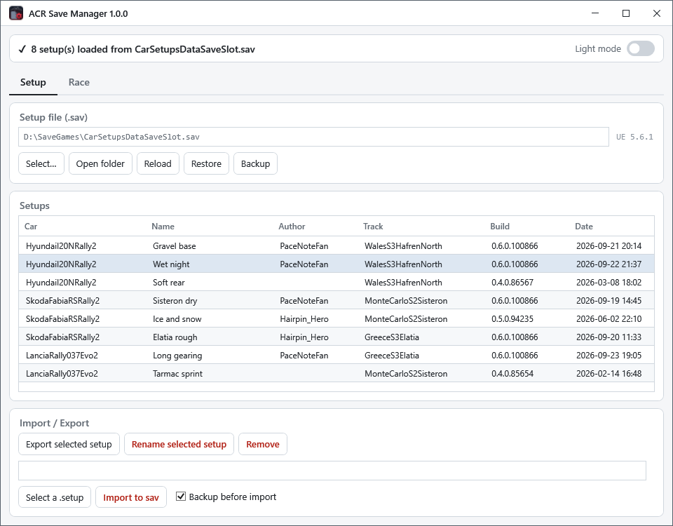
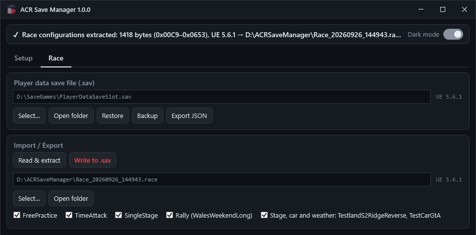

# ACR Save Manager

[](https://github.com/FlorentDChamps/acr-save-manager/actions/workflows/build.yml)

**Gestionnaire de sauvegardes pour Assetto Corsa Rally — partager ses setups et ses configurations de course, garder des backups.**

*Lire ce document en [anglais / English](README.md).*

ACR enferme chaque setup voiture et chaque configuration d'événement dans des
fichiers de sauvegarde binaires Unreal Engine, sans aucun moyen de les renommer,
supprimer, sauvegarder ou partager depuis le jeu. Cet outil ouvre ces fichiers
directement : il liste vos setups, **exporte un setup vers un fichier `.setup` que
vous pouvez envoyer à un coéquipier**, réimporte les siens, renomme et supprime des
entrées sur place, exporte les configurations de course de chaque mode de jeu — week-end
de rallye, essais libres, spéciale, voiture et météo — vers un fichier `.race` et
réécrit les parties choisies, et exporte toute la sauvegarde joueur en JSON lisible
— avec backups horodatés et restauration en un clic.

> ⚠️ **Fermez le jeu avant toute écriture.** ACR garde ses fichiers de sauvegarde
> ouverts tant qu'il tourne, et les réécrit depuis la mémoire en quittant : une
> écriture faite jeu ouvert est soit refusée, soit silencieusement écrasée. La
> lecture est toujours sans risque.

> **Projet amateur non officiel.** Sans aucune affiliation ni approbation de Kunos
> Simulazioni, Supernova Games Studios ou 505 Games. *Assetto Corsa* est une marque
> de ses propriétaires respectifs ; le nom n'est utilisé ici que pour indiquer la
> compatibilité. L'outil lit et écrit **uniquement vos fichiers de sauvegarde
> locaux**.

---

## Fonctionnalités

### Onglet Setup — setups voiture (`CarSetupsDataSaveSlot.sav`)



- **Chargement automatique** — `%LOCALAPPDATA%\acr\Saved\SaveGames\CarSetupsDataSaveSlot.sav`
  est ouvert au démarrage ; n'importe quel autre `.sav` peut être sélectionné.
- **Liste des setups** — voiture, nom, auteur, spéciale, version du jeu qui a écrit
  l'entrée et sa date. Une sauvegarde en mélange généralement plusieurs.
- **Export** du setup sélectionné vers un fichier binaire `.setup` accompagné d'un
  `.json` lisible, nommé par défaut
  `{Voiture}_{Spéciale}[_{Météo}]_{Nom}[_{Auteur}]_{Horodatage}.setup` — c'est
  cette paire que vous envoyez à un autre joueur. La météo n'apparaît dans le nom
  que si le setup n'en retient qu'une.
- **Import** d'un fichier `.setup` dans la sauvegarde courante, avec un avertissement
  s'il vient d'une autre version du jeu. Le nom du setup est toujours demandé
  (pré-rempli avec l'original, incrémenté automatiquement en cas de collision) : un
  setup importé ne remplace jamais un des vôtres en silence.
- **Rename** et **Remove** du setup sélectionné, sur place, dans le fichier.
- **Backup / Restore** du fichier de sauvegarde, et **Open folder** pour l'ouvrir
  dans l'Explorateur.

### Onglet Race (`PlayerDataSaveSlot.sav`)



La sauvegarde joueur contient une configuration d'événement par mode de jeu —
Free Practice, Time Attack, Single Stage, Rally Weekend, Online Single Stage —
puis une sélection de spéciale, voiture et météo : celle qu'affiche le menu Free
Practice, et très probablement les autres modes à spéciale unique. Seule la
config du week-end de rallye dit ce qu'elle contient, son rallye et son
itinéraire ; les autres ne contiennent que des nombres, et aucune ne nomme une
spéciale ou une voiture. Elles voyagent donc ensemble, dans un seul fichier
`.race`.

- **Read & extract** exporte les configurations de course vers un fichier `.race`,
  nommé par défaut `Race_{Horodatage}`.
- Choisir un fichier `.race` affiche ses parties — chaque mode de jeu, le week-end
  de rallye avec le nom de son rallye, puis la spéciale, la voiture et la météo —
  toutes cochées. Seules les cochées sont écrites : prenez le week-end de rallye
  d'un ami et gardez votre Free Practice.
- **Write to .sav** écrit les parties cochées dans la sauvegarde — avec
  confirmation résumée avant écriture, et mise à jour du champ de taille interne
  pour que le jeu relise le fichier. Les modes de jeu sont appariés par nom : celui
  que la sauvegarde n'a pas (un mode 0.6 écrit dans une sauvegarde 0.4) est
  ignoré, et le résumé le dit.
- **Export JSON** exporte toute la sauvegarde joueur en document JSON structuré,
  pour inspection ou comparaison entre versions du jeu.
- **Backup / Restore** du fichier de sauvegarde.

### Backups

| Opération | Backup |
|---|---|
| Rename · Remove setup · Write to .sav | `.bak` horodaté automatique |
| Import setup | case à cocher à côté du bouton, activée par défaut |
| Restore | demandé à chaque fois, avant la confirmation finale |
| Tout le reste (liste, export, JSON) | lecture seule, la sauvegarde n'est pas touchée |

Le `.bak` est écrit à côté de la sauvegarde qu'il copie, sous la forme
`{NomSauvegarde}_{aaaaMMjj_HHmmss}.bak`, et **Restore** remet n'importe lequel en place.
Les deux sauvegardes rangent leurs backups dans le même dossier, sous la même
extension : **Restore** lit donc d'abord le fichier choisi et refuse un backup de
setups dans l'onglet Race, ou un backup joueur dans l'onglet Setup.

### Vérification d'intégrité avant écriture

Chaque écriture reconstruit d'abord le fichier en mémoire, puis relit ce tampon et
contrôle les invariants du format : `size_field` cohérent avec la nouvelle taille,
nombre de setups ou chaque partie de la liste conforme à l'opération, parcours qui
se termine exactement là où il le doit. L'écriture n'a lieu que si tout est
vérifié — un format modifié par une future version du jeu fait donc échouer
l'opération au lieu de produire un fichier que le jeu refuserait.

---

## Formats de fichiers

| Extension     | Contenu |
|---------------|---------|
| `.sav`        | Fichier de sauvegarde binaire Unreal Engine 5 (format GVAS), celui du jeu |
| `.setup`      | Blob binaire brut d'une entrée setup de `CarSetupsDataSaveSlot.sav` |
| `.json`       | JSON lisible exporté à côté du `.setup`, même nom de base |
| `.race`       | Toutes les event configs de `PlayerDataSaveSlot.sav` et la sélection spéciale, voiture et météo qui les suit, précédées d'un en-tête de provenance de 16 octets |
| `.bak`        | Copie de sauvegarde horodatée d'un fichier `.sav` |

### D'où vient un fichier

Une entrée setup porte la version du jeu qui l'a écrite — `0.6.0.100866` — donc
un `.setup` indique lui-même son origine. L'appli l'affiche par entrée, dans la
colonne Build et à côté du `.setup` en attente d'import : un fichier de sauvegarde
n'a pas de version unique, il contient des entrées écrites par plusieurs. Ce qu'un
`.sav` possède en propre, c'est sa version de moteur — c'est elle que son badge
affiche.

Les configurations de course ne portent rien de tel : l'export ajoute donc son
propre en-tête devant elles :

```
"ACRSM\0"   6 o   magic
container   2 o   uint16  version de format de cet en-tête (3)
meta_len    4 o   int32   longueur du JSON qui suit
crc32       4 o   uint32  somme de contrôle du contenu seul
meta        var   {"Engine":"5.6.1","CustomVersions":117,"Exported":"…","Tool":"…"}
contenu     var   les event configs et la sélection, inchangées
```

La réécriture d'un fichier avertit quand sa version de moteur diffère de celle de
la sauvegarde cible — un avertissement, pas un refus, les event configs 0.4 et 0.6
étant interchangeables. Les conteneurs 1 et 2 contenaient chacun un seul bloc
d'événement (`.weekend`, `.timeattack`, `.practice`, des versions précédentes) ;
ils sont refusés avec un message qui le dit.

La sauvegarde joueur, elle, n'enregistre aucune version du jeu : la version de
moteur affichée (`UE 5.6.1`) est le seul marqueur qu'elle contient.

Les structures binaires rétro-conçues sont documentées dans
[`docs/CarSetupsDataSaveSlot_structure.txt`](docs/CarSetupsDataSaveSlot_structure.txt)
et [`docs/PlayerDataSaveSlot_structure.txt`](docs/PlayerDataSaveSlot_structure.txt).

---

## Démarrage

### Prérequis

- Windows 10/11 x64
- [Runtime .NET 10 Desktop](https://dotnet.microsoft.com/fr-fr/download/dotnet/10.0)
  (le SDK pour compiler depuis les sources). S'il manque, Windows affiche au
  premier lancement de l'exe une boîte de dialogue avec le lien de téléchargement
  direct — installez-le une fois, puis relancez.

### Compilation

```
dotnet build        # build debug
publish.bat         # exe Release monofichier dans .\publish\
```

### Tests

```
dotnet test tests/ACRSaveManager.Tests
```

Les tests construisent leurs sauvegardes en code, avec des valeurs inventées. Pour
rejouer les mêmes contrôles sur vos propres sauvegardes, faites pointer
`ACRSM_SAMPLES` sur un dossier qui en contient des copies ; sans elle, ces tests
sont ignorés. Une vraie sauvegarde porte votre nom de joueur et votre progression :
ne la commitez jamais.

### Utilisation

1. **Fermez Assetto Corsa Rally.**
2. Lancez `ACRSaveManager.exe` — les deux fichiers de sauvegarde se chargent
   automatiquement s'ils sont à l'emplacement par défaut. Gardez l'exe dans un
   dossier où vous pouvez écrire : le thème, la disposition de la fenêtre et les
   derniers fichiers ouverts sont enregistrés dans un `ACRSaveManager.config` à
   côté de lui, et c'est là que vont par défaut les fichiers `.race` extraits.
3. Onglet *Setup* : sélectionnez un setup et **Export selected setup** pour le
   partager, ou **Select a .setup** → **Import to sav** pour en ajouter un reçu.
4. Onglet *Race* : **Read & extract** pour sauver les configurations de course
   de tous les modes, spéciale, voiture et météo comprises ; **Select…** un fichier
   `.race`, cochez les parties à prendre, puis **Write to .sav**.
5. Un souci ? **Restore** sélectionne un `.bak` et le remet en place.

---

## Antivirus & SmartScreen

L'`.exe` publié n'est pas signé numériquement : au premier lancement, Windows peut
donc afficher un avertissement. C'est normal pour un outil open-source non signé —
voici ce qu'il signifie et quoi faire.

- **« Windows a protégé votre ordinateur » (SmartScreen).** Signifie seulement que
  l'éditeur est inconnu, pas qu'une menace a été trouvée. Cliquez **Informations
  complémentaires → Exécuter quand même**.
- **Détection antivirus / Defender.** Un exe monofichier auto-extractible déclenche
  parfois les détecteurs heuristiques. L'application ne touche qu'à vos sauvegardes,
  à leurs backups, aux fichiers que vous exportez et à son propre `.config`, et
  n'utilise jamais le réseau. Si Defender la met en quarantaine, c'est un faux
  positif — restaurez-la depuis la quarantaine, ou compilez l'exe vous-même depuis
  les sources (`publish.bat`).

**Vérifiez votre téléchargement.** Chaque [release](https://github.com/FlorentDChamps/acr-save-manager/releases)
publie un checksum SHA-256, livré aussi dans un fichier `.sha256` à côté de l'exe.
Vérifiez que le fichier correspond avant de l'exécuter :

```
certutil -hashfile ACRSaveManager.exe SHA256
```

Si vous préférez ne faire confiance à aucun binaire préconstruit, clonez le dépôt et
lancez `publish.bat` — l'exe obtenu est l'exe que vous exécutez.

---

## État & limites

| Élément | État |
|---|---|
| Liste / export / import / rename / remove des setups | ✅ parsés et réécrits sur place |
| Extraction & écriture des configurations de course | ✅ bornes parcourues depuis la structure EventConfig, modes de jeu appariés par nom, champ de taille de la sauvegarde recalculé |
| Export JSON de la sauvegarde joueur | ✅ tout le fichier ; une section inconnue est signalée au lieu d'interrompre l'export |
| Backups | ✅ `.bak` horodaté + restauration ; automatique sur Rename, Remove et Write, optionnel sur Import et Restore |
| Écriture jeu ouvert | ❌ non supportée — le fichier est verrouillé, et ACR le réécrit en quittant |
| Setups entre versions | 🟡 la version qui a écrit chaque entrée est affichée et comparée à l'import ; un écart avertit, il ne bloque pas |

Développé contre **Assetto Corsa Rally 0.6** (Unreal Engine 5.6.1). Ce sont des
formats binaires non documentés, lus par signature et par offset : une mise à jour du
jeu peut les changer à tout moment et casser le parsing. Gardez les `.bak`.

## Structure du projet

```
src/
  Services/  parsing et modification des sauvegardes : parcours GVAS/EventConfig,
             liste d'événements et sa sélection de spéciale, conteneur des
             fichiers .race, table des setups CarSetups (liste, export, import,
             rename, remove), export JSON de la sauvegarde complète
  UI/        fenêtre WPF — contrôles SetupTab et RaceTab, sélecteurs de fichiers,
             dialogues, backups, écriture atomique, fichier de réglages de l'interface
  App        point d'entrée et gestionnaire d'erreur de dernier recours
  AppInfo    version, lue dans les métadonnées de l'assembly
docs/
  CarSetupsDataSaveSlot_structure.txt   structure rétro-conçue de la sauvegarde setups
  PlayerDataSaveSlot_structure.txt      structure rétro-conçue de la sauvegarde joueur
  screenshots/                          captures des README, sur des sauvegardes inventées
assets/
  icon.svg, icon-16.svg   visuels ; icon.ico est généré à partir d'eux
tools/
  build-icon.py           régénère assets/icon.ico depuis les deux SVG
tests/
  ACRSaveManager.Tests/   tests xUnit de src/Services sur des sauvegardes synthétiques
```

## Soutenir le projet

ACR Save Manager est gratuit et open source, développé sur mon temps personnel. Si
vous l'appréciez et voulez soutenir mon travail, vous pouvez apporter une
contribution — ça aide vraiment et ça fait toujours plaisir :

- ☕ [Ko-fi](https://ko-fi.com/florentdchamps)
- 💜 [GitHub Sponsors](https://github.com/sponsors/FlorentDChamps)

Une étoile sur le repo, un bug signalé ou simplement en parler autour de vous,
c'est déjà un vrai coup de pouce. 🙂

## Licence

Copyright (C) 2026 Florent DESCHAMPS.

Sous licence **GNU General Public License v3.0 ou ultérieure** (GPL-3.0-or-later) —
voir [LICENSE](LICENSE). Vous pouvez utiliser, étudier, partager et modifier ce
logiciel librement, mais toute version distribuée — forks modifiés compris — doit
rester open source sous la même licence. Toute redistribution propriétaire ou à
sources fermées est interdite.
