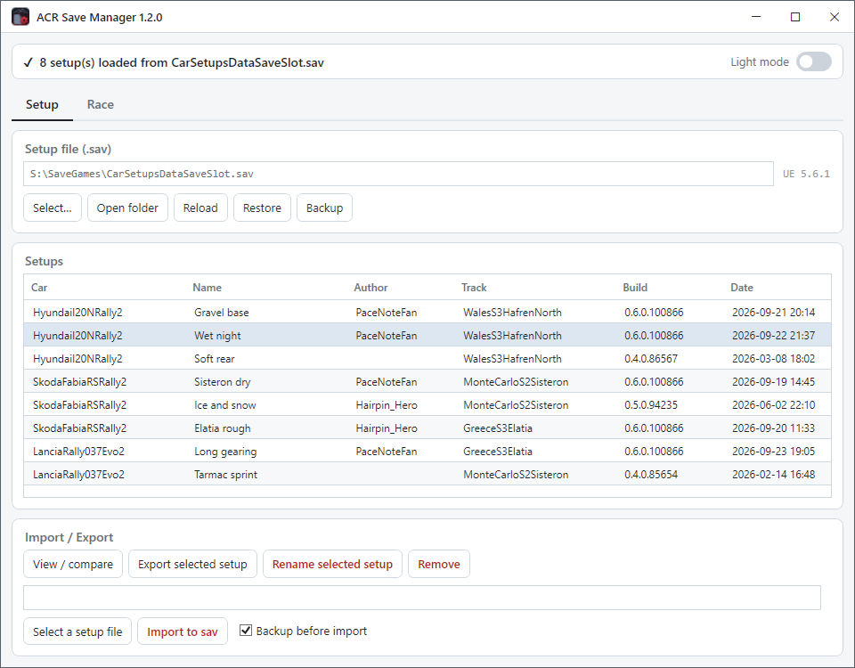
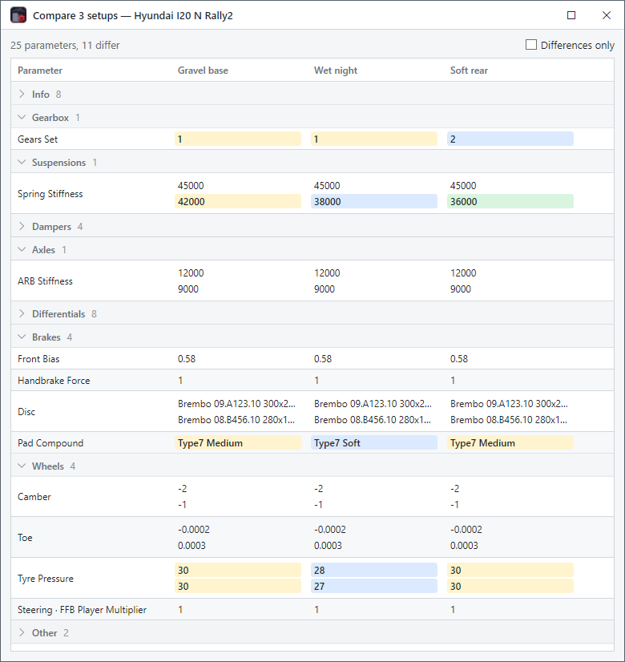

# ACR Save Manager

[](https://github.com/FlorentDChamps/acr-save-manager/actions/workflows/build.yml)

**Save file manager for Assetto Corsa Rally — share car setups and rallies, keep backups.**

*Read this in [French / en français](README.fr.md).*

ACR keeps every car setup and every event configuration locked inside binary
Unreal Engine save files, with no way to rename, delete, back up or share them from
the game. This tool opens those files directly: it lists your setups, **exports one
to a `.setup` file you can send to a teammate**, imports theirs back in, renames and
removes entries in place, edits the Rally Weekends and Single Stage and keeps a
library of rallies to load into them, picks the car the game starts with, and
dumps the whole player save as readable JSON — with timestamped backups and
one-click restore.

> ⚠️ **Close the game before writing.** ACR holds its save files open while running,
> and it rewrites them from memory when it exits — a write made while the game is
> running is either refused or silently overwritten. Reading is always safe.

> **Unofficial fan-made project.** Not affiliated with, endorsed by, or associated
> with Kunos Simulazioni, Supernova Games Studios or 505 Games. *Assetto Corsa* is a
> trademark of its respective owners; the name is used here only to indicate
> compatibility. The tool reads and writes **your own local save files** only.

> ⚠️ **Only writing carries a risk.** Reading, viewing, exporting and backing up
> change nothing in the game's files. A write — Import, Rename, Remove, Write,
> Restore — rewrites a save the game expects nobody else to touch: it can cost a
> setup or a profile, which a `.bak` puts back, and, should the game ever ship an
> anti-cheat, could pass for cheating. None ships today, and the tool checks
> before each write (see
> [Anti-cheat check before writing](#anti-cheat-check-before-writing)). You write
> at your own risk: the author is not responsible for what a write may cost.

**Contents**

- [Features](#features)
- [File formats](#file-formats)
- [Getting started](#getting-started)
- [Antivirus & SmartScreen](#antivirus--smartscreen)
- [Status & limitations](#status--limitations)
- [Project layout](#project-layout)
- [Support the project](#support-the-project)
- [License](#license)

---

## Features

### Setup tab — car setups (`CarSetupsDataSaveSlot.sav`)



The setups save holds every setup saved in the game, grouped by car. Each one
carries its name, its author, the stage it was made on, the surfaces, weathers
and game modes it is kept for, the game build that wrote it and its date — then
every parameter of the car, from the gear set to the tyre pressures. The game
shows them only in its own menus; here they become a list you can read, compare,
share and tidy up.

Ctrl+click and Shift+click select several setups: **View / compare**,
**Export** and **Remove** take them all, **Rename** one at a time.

- **Auto-load** — `%LOCALAPPDATA%\acr\Saved\SaveGames\CarSetupsDataSaveSlot.sav` is
  opened at startup; any other `.sav` can be picked instead.
- **Setup list** — car, name, author, track, the game build that wrote the entry
  and its date. One save usually mixes several builds.
- **View / compare** every parameter of the selected setup, or of several
  setups of one car side by side — see
  [Viewing and comparing setups](#viewing-and-comparing-setups).
- **Export** the selected setup to a binary `.setup` file plus a readable `.json`
  companion, named
  `{Car}_{Track}[_{Weather}]_{Name}[_{Author}]_{Timestamp}.setup` by default — that pair
  is what you send to another player. The weather is in the name only when the
  setup is kept for a single one. The `.json` is written in the format of
  [*AC Rally car setup manager*](https://www.overtake.gg/downloads/ac-rally-car-setup-manager-by-sheldor.85944/)
  by Sheldor — the parameters in readable form, and the entry itself — followed
  by the setup's weathers, game mode tags and date. Several setups selected
  together (Ctrl+click, Shift+click) are exported to a single `.json` holding
  them all, named `[{Car}_]{n}_setups_{Timestamp}.json` by default.
- **Import** a `.setup` file into the current save, or a `.json` in that format,
  whichever of the two tools wrote it, with a warning when it comes from
  another game release. A `.json` holding several setups adds them in one
  write. The setup name is always asked for (pre-filled with the
  original, auto-incremented on collision), so an imported setup never silently
  replaces one of yours; for a file of several, **Skip** leaves that setup out
  and goes on with the next, so you can take only some of them.
- **Rename** a setup and **Remove** the selected ones, in place, inside the save
  file. Several setups are removed in one write, under one backup.
- **Backup / Restore** the save file, and **Open folder** to reach it in Explorer.

#### Viewing and comparing setups



**View / compare**, or a double-click on a setup, opens a window of its own: the
main one stays free, and nothing is written. It shows the setups as they were
when it opened.

- **Info**, folded at first, holds the setup's name, author, stage, surface,
  weather, game mode, build and date.
- The parameters follow, grouped by part of the car: Gearbox, Suspensions,
  Dampers, Axles, Differentials, Brakes, Wheels, Other. A click on a group's
  header folds it.
- Values read in clear: `36.000000` is `36`, `(LSDRampAngles:45_60)` is
  `45° / 60°`, a gear set is its number in the game (`Set0` is 1), and
  `(Gears:27//8)` is `27//8`, as the game shows it.
- A parameter set per wheel takes one row, laid out as the car seen from above:
  front on top, left on the left. It shows no more detail than needed: an axle
  whose left and right match shows one value, four matching wheels a single
  one. A parameter set per axle shows front over rear, and the differentials
  split into front, rear and centre.
- Select several setups of one car to compare them: one column each, the values
  they set apart highlighted — on a row of wheels, only the wheels that differ —
  and counted at the top. Each value has a colour of its own, which the setups
  sharing it share: among three setups or more, it shows which match which.
  **Differences only** hides the rest. Setups of different cars share too few
  parameters, and are refused.
- A value too long for its column ends in "…" and shows whole under the mouse;
  Ctrl+C copies the selected rows.

The labels are the save's own keys, spaced out — `Wheels.FrontLeft.TyrePressure`
is *Tyre Pressure* on the Wheels row: the names and units the game shows on
screen are not stored in the file.

### Rally tab (`PlayerDataSaveSlot.sav`)

A rally holds every option of the game's Rally Weekend menus, offline and online
alike: the rules, the opponents and running order an offline weekend takes, the
lobby an online one takes, and the calendar stage by stage. One rally can be
written into either Rally Weekend of the save, or into both.

- **On the left**, the save's two Rally Weekends, then the **library**: the
  rallies kept as files in a `rallies` folder next to the app. Picking one shows
  it in the editor. A weekend of the save takes what it lacks from the other: the
  offline weekend gets the online one's lobby, the online weekend the offline
  one's opponents and running order.
- **The editor** shows the rules with the values the game's menus offer, then the
  calendar stage by stage — start from one of the game's calendars, add, remove
  or move stages and days, pick each stage's service park, start time, weather,
  forecast, road and time speed. It keeps the game's rules: one location, 4 days
  at most, 4 stages a day as in the menu (5 in a rally file, as the game's own
  Alsace calendar has), a service park to start each day, hardcore forcing
  damage and the realistic penalty, every value within what the menus offer.
  What the game would not take is listed at the bottom.
- **New**, **Duplicate**, **Delete** (to the Recycle Bin), **Import…** (copies
  rally files into the library) and **Open folder** manage the library.
- **Save to library** writes the rally to `rallies\<name>.json`; renaming a rally
  of the library renames its file, once you confirm, and sends the old one to
  the Recycle Bin. The files are readable JSON, made to be
  shared: send one to a friend, who imports it.
- **Write to .sav** writes the rally into the weekends ticked — offline, online
  or both — each laid out as the game stores it, with one summary to confirm,
  the result re-read first and one backup. It is refused while the game runs
  (the game would overwrite it) and in a weekend with a rally under way. What no
  menu shows (the tyre and fuel options, not in the game yet) stays the save's.
- **Single Stage**, ticked alone or with the weekends, writes the rally's first
  stage into the single-stage modes: Single Stage offline and online and Free
  Practice take the rally's rules and that stage's weather, and the stage
  selection they share takes the stage. The game keeps one stage for all of
  them, the last one shown, so they are written together; the car stays.
- **Car** picks the car the game's menus show for every mode, and **Write car**
  writes it to the save, alone: the rallies do not hold a car.
- **Export JSON** dumps the whole player save as a structured JSON document,
  for inspection or diffing between game versions.
- **Backup / Restore** the save file.

### Backups

| Operation | Backup |
|---|---|
| Rename · Remove setup · Write to .sav | automatic timestamped `.bak` |
| Import setup | checkbox next to the button, ticked by default |
| Restore | asked each time, before the final confirmation |
| Everything else (list, export, JSON) | read-only, the save is never touched |

A `.bak` is written in the `ACRSaveManager Backups` folder next to the save it
copies, as `{SaveName}_{yyyyMMdd_HHmmss}.bak`, and **Restore** puts any of them
back. The two saves keep their backups in the same folder under the same
extension, so **Restore** reads the file you pick first and refuses a setups
backup in the Rally tab, or a player backup in the Setup tab.

- **The 10 newest backups of each save are kept**; older ones go to the Recycle
  Bin as each new one is written. `BackupsKept` in `ACRSaveManager.config` sets
  the count, and `0` keeps them all.
- **No duplicate**: when the save holds the same bytes as its newest backup, no
  new one is written.
- Only files named as above are counted: rename a `.bak` (say
  `CarSetupsDataSaveSlot_before-rally.bak`) and it is kept for good.
- Backups that earlier versions wrote next to the save move into the folder the
  next time that save is backed up.

### Integrity check before writing

Every write rebuilds the file in memory first, then parses that buffer again and
checks the format invariants — `size_field` matches the new length, the setup
count or every part of the event list is what the operation intended, the walk
ends exactly where it should. The write is only performed if all of them hold,
so a save format changed by a future game version aborts the operation instead
of producing a file the game would reject.

### Anti-cheat check before writing

No anti-cheat ships with Assetto Corsa Rally today. Should one arrive with an
update, editing its saves could pass for cheating: before each write, the tool
looks for an `EasyAntiCheat` or `BattlEye` folder beside the game — beside the exe
of the running game, and beside the game in every Steam library — and refuses to
write while one is there. Reading, viewing, exporting and backing up are not
affected. A game installed outside Steam is only seen while it runs.

### Update notice at startup

A lightweight version check against this repository's releases; if a newer build
exists, a popup links to it (nothing is downloaded without your confirmation) and
can be dismissed per version. An **Update available** button stays next to the
theme toggle until you update.

---

## File formats

| Extension     | Content |
|---------------|---------|
| `.sav`        | Unreal Engine 5 GVAS binary save file (the game's own) |
| `.setup`      | Raw binary blob of one setup entry from `CarSetupsDataSaveSlot.sav` |
| `.json`       | JSON companion exported next to a `.setup`, same base name, in the format of [*AC Rally car setup manager*](https://www.overtake.gg/downloads/ac-rally-car-setup-manager-by-sheldor.85944/) by Sheldor: the parameters in readable form, their hash, and the entry in base64. Exported alone when several setups are, holding them all. It can be imported like a `.setup` |
| `rallies\*.json` | A rally of the Rally tab's library: every option of a Rally Weekend, offline and online, under the game's own names for its values |
| `.bak`        | Timestamped backup copy of a `.sav` file |

### Where a file comes from

A setup entry carries the game build that wrote it — `0.6.0.100866` — so a
`.setup` states its own origin. The app shows it per entry, in the Build column
and next to a `.setup` waiting to be imported: a save file has no single build,
it holds entries written by several. What a `.sav` does have is its engine
version, which is what its own badge shows.

The player save itself records no game version anywhere: the engine build shown
for it (`UE 5.6.1`) is the only marker it carries.

The reverse-engineered binary layouts are documented in
[`docs/CarSetupsDataSaveSlot_structure.txt`](docs/CarSetupsDataSaveSlot_structure.txt)
and [`docs/PlayerDataSaveSlot_structure.txt`](docs/PlayerDataSaveSlot_structure.txt).

---

## Getting started

### Requirements

- Windows 10/11 x64
- [.NET 10 Desktop Runtime](https://dotnet.microsoft.com/download/dotnet/10.0)
  (the SDK if you build from source). If it is missing, Windows shows a dialog
  with a direct download link the first time you launch the exe — install it
  once, then relaunch.

### Build

```
dotnet build        # debug build
publish.bat         # single-file Release exe in .\publish\
```

### Tests

```
dotnet test tests/ACRSaveManager.Tests
```

The tests build their saves in code from made-up values. To replay the same
checks on your own saves, point `ACRSM_SAMPLES` at a folder holding copies of
them; those tests are skipped otherwise. Real saves carry your player name and
progress: never commit them.

### Use

1. **Close Assetto Corsa Rally.**
2. Start `ACRSaveManager.exe` — both save files load automatically if they are in
   the default location. Keep the exe in a folder you can write to: the theme, the
   window layout and the last files opened are saved to an `ACRSaveManager.config`
   next to it, and the library of rallies is the `rallies` folder beside it.
3. *Setup* tab: pick a setup and **View / compare** to read it — or select
   several to compare them —, **Export selected setup** to share it, or
   **Select a setup file** → **Import to sav** to add one you received.
4. *Rally* tab: pick one of the save's Rally Weekends or a rally of the library,
   change it, then **Save to library** to keep it, or tick where it goes —
   Offline, Online, Single Stage — and **Write to .sav**.
5. Anything went wrong? **Restore** picks a `.bak` and puts it back.

---

## Antivirus & SmartScreen

The published `.exe` is not code-signed, so on first launch Windows may show a
warning. It is expected for an unsigned open-source tool — here is what it means
and what to do.

- **"Windows protected your PC" (SmartScreen).** This only means the publisher is
  unrecognised, not that a threat was found. Click **More info → Run anyway**.
- **Antivirus / Defender flag.** A single self-extracting exe sometimes trips
  heuristic detectors. The app touches nothing but your save files, their backups,
  the files you export and its own `.config`, and uses the network for one thing
  only: asking GitHub at startup whether a newer release exists. If
  Defender quarantines it, it is a false positive — restore it from quarantine, or
  build the exe yourself from source (`publish.bat`).

**Verify your download.** Each [release](https://github.com/FlorentDChamps/acr-save-manager/releases)
lists a SHA-256 checksum, also shipped as a `.sha256` file next to the exe. Confirm
the file matches before running:

```
certutil -hashfile ACRSaveManager.exe SHA256
```

If you would rather not trust a prebuilt binary at all, clone the repo and run
`publish.bat` — the exe you get is the exe you ran.

---

## Status & limitations

| Element | Status |
|---|---|
| Setup list / export / import / rename / remove | ✅ parsed and rewritten in place |
| Setup viewer & comparison | 🟡 every parameter, by its key in the save: the game's own labels and units are not stored there |
| Rally tab: editor & library | ✅ every setting read, offline and online, and checked to write back byte for byte; a written weekend is re-read before writing, and the game loads an edited one (tested in game 0.7); a library file reads back to the same rally |
| Rally tab: Single Stage | ✅ the Single Stage and Free Practice settings and the stage selection are decoded and checked on saves changed in the menus; the game loads what is written (tested in game 0.7) |
| Rally tab: car | 🟡 the save's car is read and rewritten, the rest checked unchanged; not tested in game yet |
| Player save JSON export | ✅ the whole file; unknown sections are reported instead of aborting the export |
| Backups | ✅ timestamped `.bak` + restore; automatic on Rename, Remove and Write, optional on Import and Restore; the 10 newest kept per save |
| Writing while the game runs | ❌ not supported — ACR keeps its settings in memory and rewrites the file as soon as a menu setting changes, and on exit |
| Anti-cheat beside the game | ✅ an `EasyAntiCheat` or `BattlEye` folder beside the running game, or beside the game in a Steam library, refuses every write — none ships with the game today |
| Cross-version setups | 🟡 the build that wrote each entry is shown and compared at import; a mismatch warns, it does not block |
| Setup JSON of *AC Rally car setup manager* | 🟡 written and read; a file edited by hand is refused, and the friendly car name may differ from that tool's for a car missing from its list |

Built against **Assetto Corsa Rally 0.6** (Unreal Engine 5.6.1). These are
undocumented binary formats read by signature and offset: a game update can change
them at any time and break parsing. Keep the `.bak` files.

## Project layout

```
src/
  Services/  save file parsing and mutation: GVAS/EventConfig walker, the
             event list and its stage selection,
             CarSetups setup table (list, export, import, rename, remove) and
             its setup-sharing JSON, the rows of the setup viewer, backup
             folder and rotation, whole-save JSON exporter, where the game is
             and the anti-cheat folders beside it, the Rally Weekend settings,
             rallies and their library files, and the names the community
             catalog gives them
  UI/        WPF window — SetupTab and RallyTab controls, rally
             editor, setup viewer, file
             pickers, dialogs, backups, atomic save writes, the anti-cheat guard
             on every write, UI settings file
  Updates/   startup release check (GitHub API)
  App        entry point and last-chance error handler
  AppInfo    version, read from the assembly metadata
docs/
  CarSetupsDataSaveSlot_structure.txt   reverse-engineered setup save layout
  PlayerDataSaveSlot_structure.txt      reverse-engineered player save layout
  screenshots/                          README screenshots, taken on made-up saves
assets/
  icon.svg, icon-16.svg   artwork; icon.ico is generated from them
  catalog.json            the community catalog, embedded: names of stages,
                          calendars and race options
tools/
  build-icon.py           rebuilds assets/icon.ico from the two SVGs
tests/
  ACRSaveManager.Tests/   xUnit tests of src/Services on synthetic saves
```

## Support the project

ACR Save Manager is free and open source, built on personal time. If you enjoy it and
want to support my work, you can make a contribution — it genuinely helps and is
much appreciated:

- ☕ [Ko-fi](https://ko-fi.com/florentdchamps)
- 💜 [GitHub Sponsors](https://github.com/sponsors/FlorentDChamps)

A star on the repo, a bug report or simply spreading the word already goes a long
way. 🙂

## License

Copyright (C) 2026 Florent DESCHAMPS.

Licensed under the **GNU General Public License v3.0 or later** (GPL-3.0-or-later) —
see [LICENSE](LICENSE). You may use, study, share and modify this software freely, but
any distributed version — including modified forks — must remain open source under the
same license. Closed-source or proprietary redistribution is not permitted.

The names of stages, Rally Weekend calendars and race options come from the
[Assetto Corsa Rally – Catalog](https://github.com/dminotte/assetto-corsa-rally-catalog),
licensed under [CC BY 4.0](https://creativecommons.org/licenses/by/4.0/), embedded
unchanged as `assets/catalog.json`.
