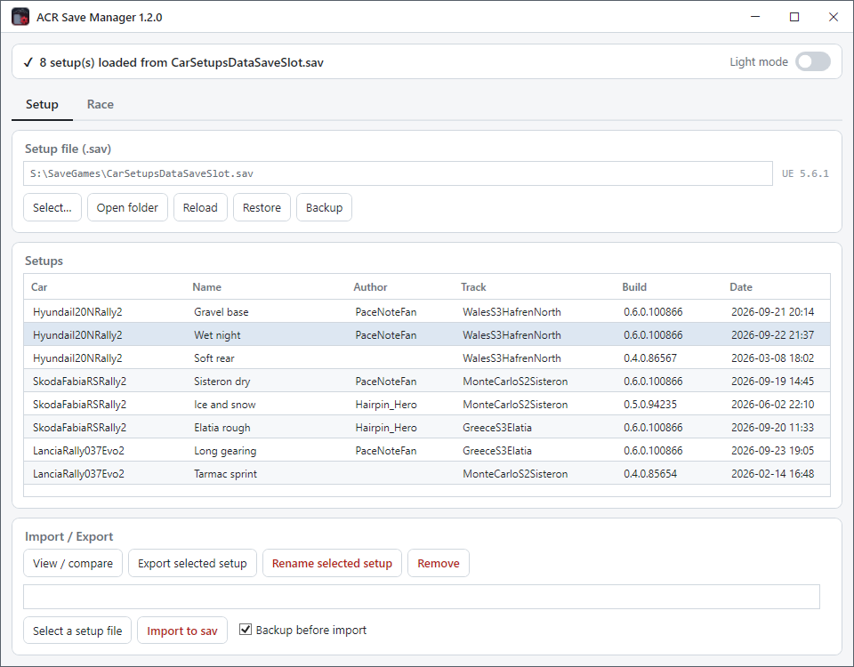
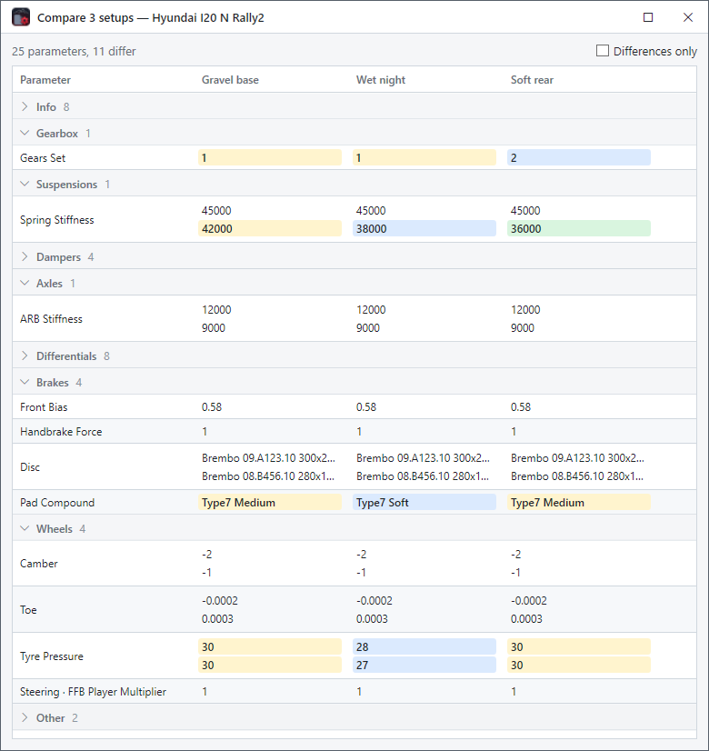
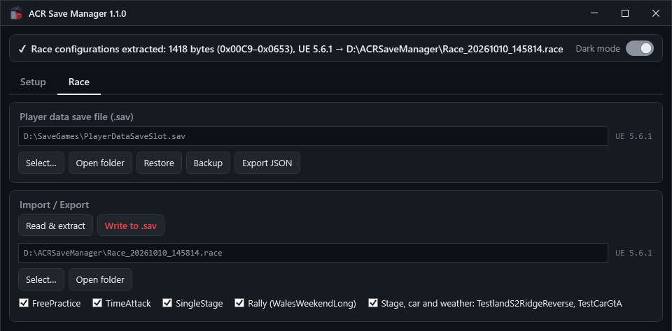

# ACR Save Manager

[](https://github.com/FlorentDChamps/acr-save-manager/actions/workflows/build.yml)

**Save file manager for Assetto Corsa Rally — share car setups and race configurations, keep backups.**

*Read this in [French / en français](README.fr.md).*

ACR keeps every car setup and every event configuration locked inside binary
Unreal Engine save files, with no way to rename, delete, back up or share them from
the game. This tool opens those files directly: it lists your setups, **exports one
to a `.setup` file you can send to a teammate**, imports theirs back in, renames and
removes entries in place, exports the race configurations of every game mode — rally
weekend, free practice, stage, car and weather — to a `.race` file and writes back
the parts you pick, and dumps the whole player save as readable JSON — with
timestamped backups and one-click restore.

> ⚠️ **Close the game before writing.** ACR holds its save files open while running,
> and it rewrites them from memory when it exits — a write made while the game is
> running is either refused or silently overwritten. Reading is always safe.

> **Unofficial fan-made project.** Not affiliated with, endorsed by, or associated
> with Kunos Simulazioni, Supernova Games Studios or 505 Games. *Assetto Corsa* is a
> trademark of its respective owners; the name is used here only to indicate
> compatibility. The tool reads and writes **your own local save files** only.

---

## Features

### Setup tab — car setups (`CarSetupsDataSaveSlot.sav`)



The setups save holds every setup saved in the game, grouped by car. Each one
carries its name, its author, the stage it was made on, the surfaces, weathers
and game modes it is kept for, the game build that wrote it and its date — then
every parameter of the car, from the gear set to the tyre pressures. The game
shows them only in its own menus; here they become a list you can read, compare,
share and tidy up.

Ctrl+click and Shift+click select several setups: **View / compare**,
**Export** and **Remove** take them all, **Rename** one at a time.

- **Auto-load** — `%LOCALAPPDATA%\acr\Saved\SaveGames\CarSetupsDataSaveSlot.sav` is
  opened at startup; any other `.sav` can be picked instead.
- **Setup list** — car, name, author, track, the game build that wrote the entry
  and its date. One save usually mixes several builds.
- **View / compare** every parameter of the selected setup, or of several
  setups of one car side by side — see
  [Viewing and comparing setups](#viewing-and-comparing-setups).
- **Export** the selected setup to a binary `.setup` file plus a readable `.json`
  companion, named
  `{Car}_{Track}[_{Weather}]_{Name}[_{Author}]_{Timestamp}.setup` by default — that pair
  is what you send to another player. The weather is in the name only when the
  setup is kept for a single one. The `.json` is written in the format of
  [*AC Rally car setup manager*](https://www.overtake.gg/downloads/ac-rally-car-setup-manager-by-sheldor.85944/)
  by Sheldor — the parameters in readable form, and the entry itself — followed
  by the setup's weathers, game mode tags and date. Several setups selected
  together (Ctrl+click, Shift+click) are exported to a single `.json` holding
  them all, named `[{Car}_]{n}_setups_{Timestamp}.json` by default.
- **Import** a `.setup` file into the current save, or a `.json` in that format,
  whichever of the two tools wrote it, with a warning when it comes from
  another game release. A `.json` holding several setups adds them in one
  write. The setup name is always asked for (pre-filled with the
  original, auto-incremented on collision), so an imported setup never silently
  replaces one of yours; for a file of several, **Skip** leaves that setup out
  and goes on with the next, so you can take only some of them.
- **Rename** a setup and **Remove** the selected ones, in place, inside the save
  file. Several setups are removed in one write, under one backup.
- **Backup / Restore** the save file, and **Open folder** to reach it in Explorer.

#### Viewing and comparing setups



**View / compare**, or a double-click on a setup, opens a window of its own: the
main one stays free, and nothing is written. It shows the setups as they were
when it opened.

- **Info**, folded at first, holds the setup's name, author, stage, surface,
  weather, game mode, build and date.
- The parameters follow, grouped by part of the car: Gearbox, Suspensions,
  Dampers, Axles, Differentials, Brakes, Wheels, Other. A click on a group's
  header folds it.
- Values read in clear: `36.000000` is `36`, `(Gears:27//8)` is `27:8 (3.375)`
  — the teeth, then the ratio —, `(LSDRampAngles:45_60)` is `45° / 60°`, and a
  gear set is its number in the game (`Set0` is 1).
- A parameter set per wheel takes one row, laid out as the car seen from above:
  front on top, left on the left. It shows no more detail than needed: an axle
  whose left and right match shows one value, four matching wheels a single
  one. A parameter set per axle shows front over rear, and the differentials
  split into front, rear and centre.
- Select several setups of one car to compare them: one column each, the values
  they set apart highlighted — on a row of wheels, only the wheels that differ —
  and counted at the top. **Differences only** hides the rest. Setups of
  different cars share too few parameters, and are refused.
- A value too long for its column ends in "…" and shows whole under the mouse;
  Ctrl+C copies the selected rows.

The labels are the save's own keys, spaced out — `Wheels.FrontLeft.TyrePressure`
is *Tyre Pressure* on the Wheels row: the names and units the game shows on
screen are not stored in the file.

### Race tab (`PlayerDataSaveSlot.sav`)



The player save holds one event config per game mode — Free Practice, Time
Attack, Single Stage, Rally Weekend, Online Single Stage — then a stage, car
and weather selection: the one the Free Practice menu shows, and most likely the
other single-stage modes too. Only the rally weekend's config says what it holds,
its rally and its itinerary; the others hold numbers only, and none names a stage
or a car. So they travel together, in one `.race` file.

- **Read & extract** the race configurations to a `.race` file, named
  `Race_{Timestamp}` by default.
- Picking a `.race` file lists its parts — each game mode, the rally weekend
  with its rally name, then the stage, car and weather — all ticked. Only the
  ticked ones are written: take a friend's rally weekend and keep your own Free
  Practice.
- **Write to .sav** puts the ticked parts into the save — with a summary
  confirmation before writing, and the save's internal size field fixed up so
  the game still reads the file. Game modes are matched by name, so one the save
  lacks (a 0.6 mode written into a 0.4 save) is skipped, and the summary says so.
- **Export JSON** dumps the whole player save as a structured JSON document,
  for inspection or diffing between game versions.
- **Backup / Restore** the save file.

### Backups

| Operation | Backup |
|---|---|
| Rename · Remove setup · Write to .sav | automatic timestamped `.bak` |
| Import setup | checkbox next to the button, ticked by default |
| Restore | asked each time, before the final confirmation |
| Everything else (list, export, JSON) | read-only, the save is never touched |

A `.bak` is written in the `ACRSaveManager Backups` folder next to the save it
copies, as `{SaveName}_{yyyyMMdd_HHmmss}.bak`, and **Restore** puts any of them
back. The two saves keep their backups in the same folder under the same
extension, so **Restore** reads the file you pick first and refuses a setups
backup in the Race tab, or a player backup in the Setup tab.

- **The 10 newest backups of each save are kept**; older ones go to the Recycle
  Bin as each new one is written. `BackupsKept` in `ACRSaveManager.config` sets
  the count, and `0` keeps them all.
- **No duplicate**: when the save holds the same bytes as its newest backup, no
  new one is written.
- Only files named as above are counted: rename a `.bak` (say
  `CarSetupsDataSaveSlot_before-rally.bak`) and it is kept for good.
- Backups that earlier versions wrote next to the save move into the folder the
  next time that save is backed up.

### Integrity check before writing

Every write rebuilds the file in memory first, then parses that buffer again and
checks the format invariants — `size_field` matches the new length, the setup
count or every part of the event list is what the operation intended, the walk
ends exactly where it should. The write is only performed if all of them hold,
so a save format changed by a future game version aborts the operation instead
of producing a file the game would reject.

### Update notice at startup

A lightweight version check against this repository's releases; if a newer build
exists, a popup links to it (nothing is downloaded without your confirmation) and
can be dismissed per version. An **Update available** button stays next to the
theme toggle until you update.

---

## File formats

| Extension     | Content |
|---------------|---------|
| `.sav`        | Unreal Engine 5 GVAS binary save file (the game's own) |
| `.setup`      | Raw binary blob of one setup entry from `CarSetupsDataSaveSlot.sav` |
| `.json`       | JSON companion exported next to a `.setup`, same base name, in the format of [*AC Rally car setup manager*](https://www.overtake.gg/downloads/ac-rally-car-setup-manager-by-sheldor.85944/) by Sheldor: the parameters in readable form, their hash, and the entry in base64. Exported alone when several setups are, holding them all. It can be imported like a `.setup` |
| `.race`       | Every event config of `PlayerDataSaveSlot.sav` and the stage, car and weather selection past them, behind a 16-byte provenance header |
| `.bak`        | Timestamped backup copy of a `.sav` file |

### Where a file comes from

A setup entry carries the game build that wrote it — `0.6.0.100866` — so a
`.setup` states its own origin. The app shows it per entry, in the Build column
and next to a `.setup` waiting to be imported: a save file has no single build,
it holds entries written by several. What a `.sav` does have is its engine
version, which is what its own badge shows.

The race configurations carry nothing of the sort, so the exporter adds a
header of its own in front of them:

```
"ACRSM\0"   6 B   magic
container   2 B   uint16  format version of this header (3)
meta_len    4 B   int32   length of the JSON that follows
crc32       4 B   uint32  checksum of the content alone
meta        var   {"Engine":"5.6.1","CustomVersions":117,"Exported":"…","Tool":"…"}
content     var   the event configs and the selection, untouched
```

Writing a file back warns when its engine build differs from the target save —
a warning, not a refusal, since 0.4 and 0.6 event configs are interchangeable.
Containers 1 and 2 held one event block each (`.weekend`, `.timeattack`,
`.practice`, from earlier builds); they are refused with a message that says so.

The player save itself records no game version anywhere: the engine build shown
for it (`UE 5.6.1`) is the only marker it carries.

The reverse-engineered binary layouts are documented in
[`docs/CarSetupsDataSaveSlot_structure.txt`](docs/CarSetupsDataSaveSlot_structure.txt)
and [`docs/PlayerDataSaveSlot_structure.txt`](docs/PlayerDataSaveSlot_structure.txt).

---

## Getting started

### Requirements

- Windows 10/11 x64
- [.NET 10 Desktop Runtime](https://dotnet.microsoft.com/download/dotnet/10.0)
  (the SDK if you build from source). If it is missing, Windows shows a dialog
  with a direct download link the first time you launch the exe — install it
  once, then relaunch.

### Build

```
dotnet build        # debug build
publish.bat         # single-file Release exe in .\publish\
```

### Tests

```
dotnet test tests/ACRSaveManager.Tests
```

The tests build their saves in code from made-up values. To replay the same
checks on your own saves, point `ACRSM_SAMPLES` at a folder holding copies of
them; those tests are skipped otherwise. Real saves carry your player name and
progress: never commit them.

### Use

1. **Close Assetto Corsa Rally.**
2. Start `ACRSaveManager.exe` — both save files load automatically if they are in
   the default location. Keep the exe in a folder you can write to: the theme, the
   window layout and the last files opened are saved to an `ACRSaveManager.config`
   next to it, and extracted `.race` files go to that folder by default.
3. *Setup* tab: pick a setup and **View / compare** to read it — or select
   several to compare them —, **Export selected setup** to share it, or
   **Select a setup file** → **Import to sav** to add one you received.
4. *Race* tab: **Read & extract** to save the race configurations of every mode,
   stage, car and weather included; **Select…** a `.race` file, tick the parts to
   take, then **Write to .sav**.
5. Anything went wrong? **Restore** picks a `.bak` and puts it back.

---

## Antivirus & SmartScreen

The published `.exe` is not code-signed, so on first launch Windows may show a
warning. It is expected for an unsigned open-source tool — here is what it means
and what to do.

- **"Windows protected your PC" (SmartScreen).** This only means the publisher is
  unrecognised, not that a threat was found. Click **More info → Run anyway**.
- **Antivirus / Defender flag.** A single self-extracting exe sometimes trips
  heuristic detectors. The app touches nothing but your save files, their backups,
  the files you export and its own `.config`, and uses the network for one thing
  only: asking GitHub at startup whether a newer release exists. If
  Defender quarantines it, it is a false positive — restore it from quarantine, or
  build the exe yourself from source (`publish.bat`).

**Verify your download.** Each [release](https://github.com/FlorentDChamps/acr-save-manager/releases)
lists a SHA-256 checksum, also shipped as a `.sha256` file next to the exe. Confirm
the file matches before running:

```
certutil -hashfile ACRSaveManager.exe SHA256
```

If you would rather not trust a prebuilt binary at all, clone the repo and run
`publish.bat` — the exe you get is the exe you ran.

---

## Status & limitations

| Element | Status |
|---|---|
| Setup list / export / import / rename / remove | ✅ parsed and rewritten in place |
| Setup viewer & comparison | 🟡 every parameter, by its key in the save: the game's own labels and units are not stored there |
| Race configurations extract & write | ✅ boundaries walked from the EventConfig structure, game modes matched by name, save size field fixed up |
| Player save JSON export | ✅ the whole file; unknown sections are reported instead of aborting the export |
| Backups | ✅ timestamped `.bak` + restore; automatic on Rename, Remove and Write, optional on Import and Restore; the 10 newest kept per save |
| Writing while the game runs | ❌ not supported — the file is locked, and ACR rewrites it on exit |
| Cross-version setups | 🟡 the build that wrote each entry is shown and compared at import; a mismatch warns, it does not block |
| Setup JSON of *AC Rally car setup manager* | 🟡 written and read; a file edited by hand is refused, and the friendly car name may differ from that tool's for a car missing from its list |

Built against **Assetto Corsa Rally 0.6** (Unreal Engine 5.6.1). These are
undocumented binary formats read by signature and offset: a game update can change
them at any time and break parsing. Keep the `.bak` files.

## Project layout

```
src/
  Services/  save file parsing and mutation: GVAS/EventConfig walker, the
             event list and its stage selection, .race file container,
             CarSetups setup table (list, export, import, rename, remove) and
             its setup-sharing JSON, the rows of the setup viewer, backup
             folder and rotation, whole-save JSON exporter
  UI/        WPF window — SetupTab and RaceTab controls, setup viewer, file
             pickers, dialogs, backups, atomic save writes, UI settings file
  Updates/   startup release check (GitHub API)
  App        entry point and last-chance error handler
  AppInfo    version, read from the assembly metadata
docs/
  CarSetupsDataSaveSlot_structure.txt   reverse-engineered setup save layout
  PlayerDataSaveSlot_structure.txt      reverse-engineered player save layout
  screenshots/                          README screenshots, taken on made-up saves
assets/
  icon.svg, icon-16.svg   artwork; icon.ico is generated from them
tools/
  build-icon.py           rebuilds assets/icon.ico from the two SVGs
tests/
  ACRSaveManager.Tests/   xUnit tests of src/Services on synthetic saves
```

## Support the project

ACR Save Manager is free and open source, built on personal time. If you enjoy it and
want to support my work, you can make a contribution — it genuinely helps and is
much appreciated:

- ☕ [Ko-fi](https://ko-fi.com/florentdchamps)
- 💜 [GitHub Sponsors](https://github.com/sponsors/FlorentDChamps)

A star on the repo, a bug report or simply spreading the word already goes a long
way. 🙂

## License

Copyright (C) 2026 Florent DESCHAMPS.

Licensed under the **GNU General Public License v3.0 or later** (GPL-3.0-or-later) —
see [LICENSE](LICENSE). You may use, study, share and modify this software freely, but
any distributed version — including modified forks — must remain open source under the
same license. Closed-source or proprietary redistribution is not permitted.
